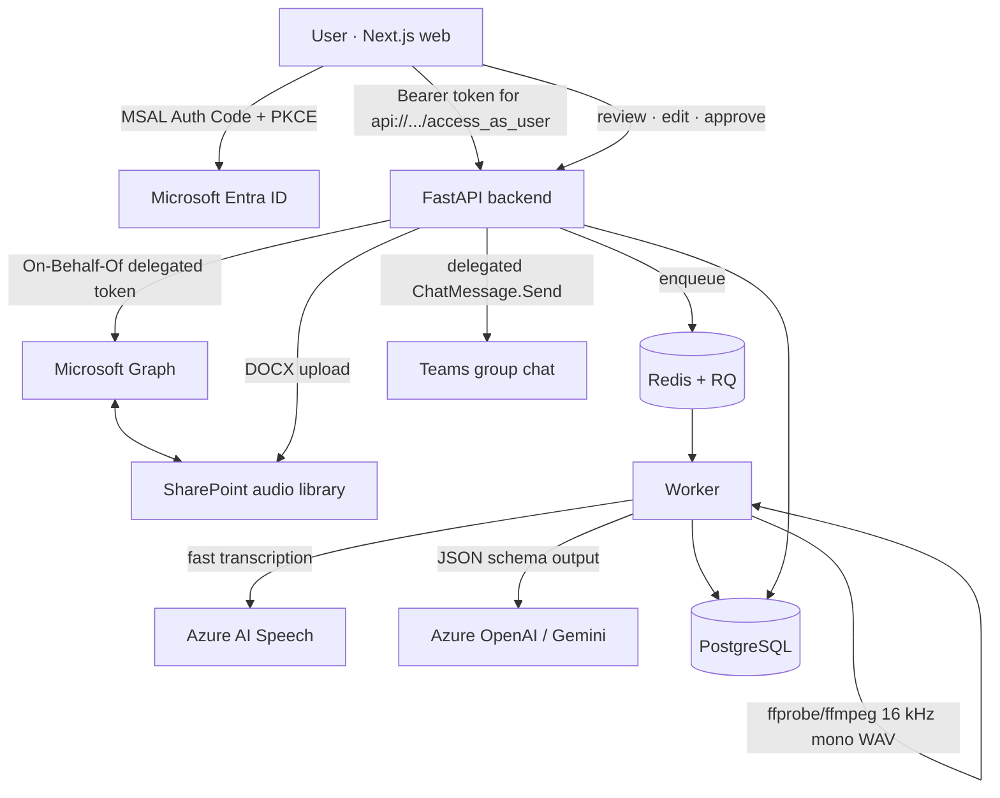

# Architecture



## Why the work is split this way

| Concern | Decision |
|---|---|
| User tokens | Never stored. The API exchanges the incoming token via OBO per request. SharePoint download, DOCX upload and Teams send therefore run inside the user's request; the worker never holds a user token. |
| Long work | Convert → transcribe → summarise runs in an RQ worker with per-stage rows in `processing_jobs` (no fake percentages). Completed stages are skipped on retry. |
| STT | Azure AI Speech fast transcription (file upload, phrase timestamps). Files longer than `STT_CHUNK_SECONDS` are split and offsets re-applied. |
| Anti-hallucination | The LLM sees numbered segments `[S#]` and can only cite numbers; the server attaches timestamps. `validate_summary` drops uncited decisions/actions, nulls owners/dates not present in the cited text, and downgrades `resolved` without a stated resolution to `mentioned`. |
| Human review | Every edit bumps the report version and invalidates approval. Export and publish require approval of the *current* version. |
| Duplicate sends | `team_publications.idempotency_key` (meeting + version + chat) is UNIQUE. A timeout is recorded as `unknown`; before any retry the chat is searched for the message's reference code. |
| Chat targeting | `chat_id` from the client is accepted only if it is in the user's own `chatType == group` list (re-fetched server-side). |
| Mock mode | Every integration has a mock (`AUTH_MODE`, `GRAPH_MODE`, `STT_PROVIDER`, `SUMMARIZER`) so the full journey runs before IT approval (plan §10). Mock auth is refused when `ENVIRONMENT=production`. |

## Code map

```text
backend/app/
  api/            meetings.py (13 plan endpoints + extras), sharepoint.py, teams.py, me.py
  auth/           entra.py (JWT validation, OBO), dependencies.py (current user, mock users)
  services/       sharepoint.py, speech_to_text.py, summarizer.py, teams.py, exporter.py,
                  graph_client.py, audio.py, jobs.py, audit.py, rate_limit.py
  workers/        pipeline.py (RQ job + retention cleanup)
  models/         SQLAlchemy tables from plan §6 + chat_mappings + audit_logs
frontend/
  app/            dashboard, sharepoint, new (upload/record), meetings/[id], reports, settings
  components/     Transcript (timeline + evidence linking), ReviewEditor, PublishPanel, Recorder …
  lib/            auth (MSAL / mock), api client, types
```

## Status model

`pending → processing → awaiting_review → reviewed (approved) → published`, with `failed` from
`processing` (retry allowed). Editing after approval or publication returns the meeting to
`awaiting_review`; publishing an edited version creates a new publication record.
