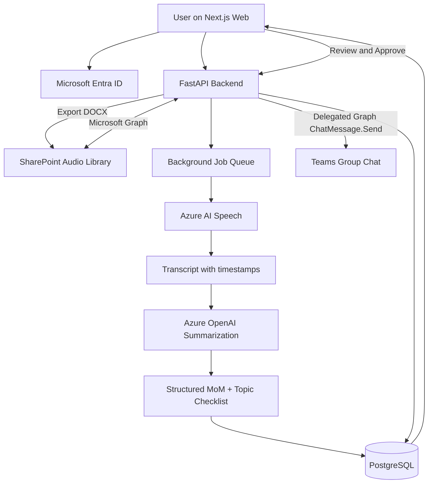

# AI Meeting Minutes Platform — Development Plan

> โครงงานสหกิจศึกษา: AI-Driven Innovation for MoM Recognition and Platform Transformation  
> หน่วยงานตามเอกสาร: KASIKORN Business-Technology Group (KBTG)  
> สถานะ: แผนพัฒนาเสนอเพื่อพิจารณา (ยังไม่ยืนยันสิทธิ์ระบบองค์กร)

## 1. ที่มาและเป้าหมาย

จากเอกสารเสนอโครงงาน ระบบต้องช่วยลดภาระการจดบันทึกประชุมและการฟังเสียงย้อนหลัง โดยรับเสียงจากการอัดผ่านเว็บหรืออัปโหลด MP3/WAV, ถอดเสียงภาษาไทย (รองรับอังกฤษเพิ่มเติม), สรุปประเด็นสำคัญ มติ และงานติดตาม, แสดง Transcript และส่งออกเอกสาร ทั้งนี้ **Speaker Diarization ไม่อยู่ในขอบเขตระยะแรก**

**ส่วนขยายที่ตกลงออกแบบเพิ่มเติม:** ใช้ SharePoint เป็นแหล่งไฟล์เสียงและที่เก็บรายงาน และส่ง AI Meeting Minutes ไปยัง **Microsoft Teams Group Chat** หลังผู้ใช้ตรวจสอบ/อนุมัติ ข้อเสนอนี้เป็นส่วนขยายจากเอกสาร ไม่ใช่ข้อกำหนดที่ยืนยันแล้วจากบริษัท

### ผลลัพธ์ที่ต้องส่งมอบ
- Web Application สำหรับเลือกไฟล์จาก SharePoint, อัปโหลด/อัดเสียง (ตามสิทธิ์และขอบเขตที่อนุมัติ), ดูสถานะงาน, ตรวจ Transcript และ MoM
- Pipeline: Audio → Speech-to-Text → Structured Summary → Human Review → Publish
- Topic checklist แยก `mentioned` (มีการพูดถึง) และ `resolved` (มีข้อสรุป) ไม่ติ๊กว่าจบเพียงเพราะถูกกล่าวถึง
- ส่งข้อความสรุปและลิงก์รายงานไป Teams Group Chat ที่เลือก
- Export Word; PDF เป็นฟีเจอร์เสริม
- ชุดทดสอบและรายงานวัดคุณภาพ

## 2. ขอบเขต MVP และงานระยะถัดไป

### MVP (ต้องทำ)
1. Microsoft Entra ID Sign-in (บัญชีองค์กรที่ได้รับอนุญาต)
2. เลือกไฟล์เสียงจาก SharePoint Document Library และดาวน์โหลดผ่าน Graph API
3. รับไฟล์ MP3/WAV จากเว็บ; อัดเสียงผ่านเบราว์เซอร์ตามขอบเขตเอกสาร (อาจทยอยเปิดหลัง flow หลัก)
4. ถอดเสียงเป็นข้อความและ timestamp ตามความสามารถบริการ
5. สรุปหัวข้อ/มติ/action items ด้วย LLM พร้อมหลักฐานอ้างอิงจาก transcript
6. หน้า Review ให้แก้ไขและอนุมัติ ก่อนส่งออก/เผยแพร่
7. Export DOCX และเก็บกลับ SharePoint ตามสิทธิ์
8. เลือก Teams **Group Chat** ที่ผู้ใช้เป็นสมาชิกและส่งข้อความหลังอนุมัติ
9. เก็บสถานะงาน ประวัติการส่ง และจัดการข้อผิดพลาด/ส่งซ้ำ

### ไม่รวมใน MVP
- แยกเสียงผู้พูด (Speaker Diarization)
- การเข้าประชุมแทนผู้ใช้หรือบันทึกเสียง Teams Meeting โดย Bot
- สรุปสดแบบ real-time streaming
- ส่งอัตโนมัติทุกกลุ่มโดยไม่ต้องอนุมัติ
- การประเมินความเสี่ยงของโครงการด้วย AI นอกเหนือจากการสรุป MoM (ต้องเก็บ requirement เพิ่ม หากเป็นเป้าหมายจริง)

## 3. สถาปัตยกรรม



**สำคัญ:** Microsoft Graph ไม่ใช่โมเดลถอดเสียง และ SharePoint ไม่ได้ส่งไฟล์เข้า AI เอง; Backend/Worker เป็นผู้จัดการการไหลของข้อมูล ภายใต้นโยบายองค์กร

### Technology Stack (ข้อเสนอ)
| Layer | เทคโนโลยี | หมายเหตุ |
|---|---|---|
| Frontend | Next.js + TypeScript + Tailwind CSS | Responsive enterprise UI |
| Backend | Python FastAPI | REST API + orchestration |
| Background jobs | Redis + RQ/Celery หรือ Azure Queue | งานเสียงอาจใช้เวลานาน; เลือกตาม infra ที่อนุมัติ |
| Identity | Microsoft Entra ID + MSAL | OAuth Authorization Code + PKCE; ฝั่ง Backend ใช้ flow ที่เหมาะสม |
| Files & Teams | Microsoft Graph API | ต้องขอสิทธิ์จริง |
| STT | Azure AI Speech | ทดสอบภาษาไทย/อังกฤษและรูปแบบไฟล์ก่อน |
| Summarization | Azure OpenAI | ต้องผ่านการอนุมัติจากบริษัท |
| Metadata | PostgreSQL | เก็บงาน/สถานะ/ข้อมูลรายงาน ไม่จำเป็นต้องเก็บเสียงซ้ำ |
| Document | python-docx | ส่งออก Word |
| Deployment | องค์กรอนุมัติ (เช่น Azure App Service/Container Apps) | ไม่ใช้ production data บน personal hosting |

## 4. การเชื่อมต่อ Microsoft 365

### 4.1 สิ่งที่ต้องขอจากทีม IT ก่อนเริ่ม
- Microsoft 365 tenant, SharePoint Site/Document Library และโฟลเดอร์เสียงทดสอบ
- App Registration, Tenant ID, Client ID, Redirect URI และการอนุมัติ permissions
- สิทธิ์ผู้ใช้เข้าถึงไฟล์เสียง และสิทธิ์ส่งข้อความใน Teams Group Chat ปลายทาง
- Azure subscription/บริการ AI ที่ได้รับอนุญาต, region, quota, retention, data classification
- นโยบาย consent การบันทึกเสียงประชุม, การประมวลผลด้วย AI, และการเผยแพร่ในแชท
- แนวทางจัดเก็บ secrets (เช่น Key Vault) และ logging ที่ไม่รั่วข้อมูล

### 4.2 Microsoft Graph API endpoints หลัก
```http
GET  /v1.0/sites/{site-id}/drives
GET  /v1.0/drives/{drive-id}/root/children
GET  /v1.0/drives/{drive-id}/items/{item-id}/content
GET  /v1.0/me/chats
POST /v1.0/chats/{chat-id}/messages
PUT  /v1.0/drives/{drive-id}/root:/MeetingReports/{filename}:/content
```

- `GET /me/chats` ต้องกรอง `chatType == group`, รองรับ pagination และตรวจสอบสมาชิก/สิทธิ์ตามนโยบาย
- `POST /chats/{chat-id}/messages` สำหรับการส่งข้อความปกติใช้ **delegated** `ChatMessage.Send` และ token ของผู้ใช้ที่ได้รับอนุญาต; **ไม่ใช้ client credentials application token เพื่อส่งแชทปกติ**
- สิทธิ์อ่าน SharePoint ต้องเลือกให้แคบที่สุดเท่าที่ใช้งานได้; อาจใช้ delegated files/sites scopes หรือ application `Sites.Selected` พร้อม site grant ขึ้นกับ architecture ที่ IT อนุมัติ
- การเขียนไฟล์กลับ SharePoint ต้องมีสิทธิ์เขียนเพิ่มจากสิทธิ์อ่าน
- ตรวจสอบความถูกต้องของ Graph scopes/consent และ endpoint อีกครั้งกับเอกสาร Microsoft ปัจจุบันก่อน implementation

### 4.3 กลยุทธ์การส่ง Teams
**MVP:** ผู้ใช้ Sign-in → เลือก Group Chat → กด Approve & Publish → Backend ส่งผ่าน Graph delegated token → บันทึก `message_id` และเวลา

**ทางเลือกอนาคต:** Power Automate ส่งในนาม Flow bot หลังมี trigger/approval ที่ชัดเจน หากบริษัทต้องการส่งโดยไม่ต้องมีผู้ใช้ออนไลน์ ต้องทดสอบ connector policy และสิทธิ์แชทกับ IT

**การจับคู่เสียงกับกลุ่ม:** ไม่สมมติว่า SharePoint รู้ Group Chat ปลายทางเอง ให้ผู้ใช้เลือกใน UI และบันทึก mapping ที่ผ่านการยืนยัน (เช่น `meeting_id -> chat_id`)

## 5. UX/UI และหน้าจอ

1. **Login & Access:** Sign in Microsoft 365, แสดงสถานะสิทธิ์ที่จำเป็น
2. **Dashboard:** จำนวนงาน, งานล่าสุด, สถานะ pending/processing/reviewed/published/failed
3. **SharePoint Browser:** เลือก Site/Library/Folder, ค้นหาไฟล์เสียง, เลือกไฟล์เข้า processing
4. **Record/Upload:** อัปโหลด MP3/WAV หรืออัดเสียงผ่าน browser (MediaRecorder), แสดง consent และข้อจำกัดไฟล์
5. **Processing:** progress ตามขั้นตอน ไม่แสดงเปอร์เซ็นต์ปลอมหาก backend ไม่มี progress จริง; retry ที่ปลอดภัย
6. **Transcript & Summary:** audio player, transcript พร้อม timestamp, แสดงหัวข้อ/มติ/action items คู่กัน
7. **Topic Checklist:** สถานะ `not_mentioned`, `mentioned`, `resolved`, `unclear` พร้อม evidence/timestamp; ผู้ใช้แก้ไขได้
8. **Review & Publish:** preview ข้อความ Teams, เลือก Group Chat, ยืนยันผู้รับและกด Approve & Publish
9. **Reports & History:** เปิด DOCX, SharePoint link, ประวัติการส่ง, ผู้อนุมัติ และข้อผิดพลาด
10. **Settings:** ภาษาถอดเสียง, SharePoint location, policy ที่ได้รับอนุญาต

### User Journey
`Sign in → Select Audio → Process → Inspect Transcript → Edit MoM & Checklist → Choose Group Chat → Approve → Send → View Status`

## 6. โครงสร้างข้อมูล (ร่าง)

```text
users(id, entra_oid, display_name, created_at)
meetings(id, title, created_by, source_drive_id, source_item_id,
         source_web_url, language, status, created_at, completed_at)
processing_jobs(id, meeting_id, stage, status, error_code, retry_count,
                started_at, finished_at)
transcripts(id, meeting_id, content_ref, language, created_at)
topics(id, meeting_id, title, status, evidence_start_ms, evidence_end_ms,
       verified_by)
action_items(id, meeting_id, description, owner_text, due_date,
             evidence_start_ms, evidence_end_ms, status)
meeting_reports(id, meeting_id, summary_json, approved_by, approved_at,
                sharepoint_report_item_id, version)
team_publications(id, meeting_id, chat_id, message_id, status,
                  approved_by, sent_at, idempotency_key, error_code)
```

- ใช้ `idempotency_key` กันการกดส่งซ้ำและเก็บ message ID เมื่อส่งสำเร็จ
- อย่าเก็บ access token เป็น plaintext; กำหนด retention ของ transcript และรายงานตามนโยบาย
- ตรวจสอบความสามารถในการเปิดลิงก์ SharePoint ของสมาชิก Group Chat ก่อนส่ง

## 7. API Backend ที่ต้องพัฒนา

| Method | Endpoint | หน้าที่ |
|---|---|---|
| GET | `/api/me` | ผู้ใช้และสิทธิ์ |
| GET | `/api/sharepoint/files` | รายชื่อไฟล์เสียงที่เข้าถึงได้ |
| POST | `/api/meetings` | สร้างรายการประชุมจากไฟล์ SharePoint |
| POST | `/api/meetings/upload` | รับไฟล์จากเว็บ (หากเปิดใช้) |
| POST | `/api/meetings/{id}/process` | เริ่ม background processing |
| GET | `/api/meetings/{id}` | สถานะและรายละเอียด |
| GET | `/api/meetings/{id}/transcript` | บทถอดเสียง |
| GET | `/api/meetings/{id}/summary` | สรุปและ checklist |
| PATCH | `/api/meetings/{id}/summary` | แก้ไขผล AI |
| POST | `/api/meetings/{id}/approve` | อนุมัติรายงาน |
| GET | `/api/teams/group-chats` | แชทกลุ่มที่เลือกได้ |
| POST | `/api/meetings/{id}/publish` | ส่งเข้า Teams หลังอนุมัติ |
| POST | `/api/meetings/{id}/export` | สร้าง DOCX/บันทึก SharePoint |

ทุก endpoint ต้องตรวจ authentication, authorization, ownership/meeting access และ input validation; ไม่ให้ client ระบุ `chat_id` ใดก็ได้โดยไม่ตรวจสอบ

## 8. AI Pipeline และกติกาคุณภาพ

### Speech-to-Text
- ตรวจชนิดไฟล์จริง, ขนาด, duration, codec และ sample rate; แปลงไฟล์เมื่อจำเป็น
- รองรับภาษาไทยเป็นหลัก; ทดสอบไทยปนอังกฤษด้วยไฟล์เสียงตัวอย่างที่ได้รับอนุญาต
- เก็บ timestamp ของช่วงคำพูดเท่าที่บริการรองรับ
- ไฟล์ยาวให้ใช้ asynchronous/batch processing ตามข้อจำกัดของบริการ

### Summarization
- ป้อน transcript เป็น chunks หากยาวเกิน context limit และรวมผลอย่างมีโครงสร้าง
- ขอผลลัพธ์แบบ JSON schema เช่น:
```json
{
  "meeting_title": "ประชุมติดตามโครงการ",
  "summary": "...",
  "topics": [
    {"title": "ออกแบบฐานข้อมูล", "status": "mentioned", "evidence": [{"start_ms": 60000, "end_ms": 90000}]}
  ],
  "decisions": [{"text": "...", "evidence": []}],
  "action_items": [{"task": "...", "owner": null, "due_date": null, "evidence": []}],
  "open_questions": []
}
```
- ห้าม AI แต่งชื่อผู้รับผิดชอบ วันที่ส่ง มติ หรือหัวข้อที่ไม่มีหลักฐานใน transcript
- ถ้าไม่ชัดเจนให้ `null` / `unclear`; แยกการพูดถึงหัวข้อกับการได้ข้อสรุป
- ไม่เผยแพร่รายงานโดยไม่ผ่าน human review ใน MVP

## 9. Security, Privacy & Compliance

- ขอความยินยอม/แจ้งผู้ร่วมประชุมตามกฎบริษัทและกฎหมายที่เกี่ยวข้องก่อนบันทึกเสียง
- ตรวจสอบ classification และข้อตกลง data processing ก่อนส่งไฟล์เสียงไป Azure AI
- Least privilege: จำกัด SharePoint sites/files และ Teams chat ที่เข้าถึงได้
- Backend ไม่เปิดเผย Azure keys, Graph tokens, หรือ transcript ใน browser logs
- ใช้ HTTPS, Key Vault/secret manager, encryption at rest, audit trail
- จำกัดไฟล์/ชนิดไฟล์, ตรวจ malware ตามมาตรฐานองค์กร, rate limit และ timeout
- ลบ temporary audio หลังประมวลผลตาม retention policy
- การ retry ส่ง Teams ต้องระวัง network timeout ที่ส่งสำเร็จแต่ไม่ได้รับ response; ตรวจประวัติการส่งก่อน retry เพื่อหลีกเลี่ยง duplicate
- จัดการ `401`, `403`, `404`, `429` (Retry-After) และ `5xx` พร้อมข้อความ UI ที่เข้าใจง่าย

## 10. แผนการพัฒนา 8 สัปดาห์

| สัปดาห์ | งาน | เกณฑ์ผ่าน |
|---|---|---|
| 1 | เก็บ requirements, สิทธิ์ IT, Entra App, test data, UX wireframe | Login + สิทธิ์ทดสอบได้รับอนุมัติ |
| 2 | Graph SharePoint browse/download และ mock API | เลือกไฟล์เสียงจาก SharePoint ได้ |
| 3 | STT pipeline + timestamps + job status | ไฟล์ทดสอบถอดเสียงได้ |
| 4 | LLM JSON summary, checklist, evidence | สรุปหัวข้อ/มติ/action items ได้และตรวจ schema ผ่าน |
| 5 | Transcript UI, review/edit, DOCX export | ผู้ใช้แก้ไขและส่งออกเอกสารได้ |
| 6 | Graph Group Chat picker + delegated send + audit | ส่งเข้ากลุ่มทดสอบหลังอนุมัติได้ |
| 7 | Browser recording/upload, robustness, security tests | ทดสอบ end-to-end และ failure paths |
| 8 | Evaluation, bug fixes, documentation, deployment/demo | Demo + รายงานผลการประเมิน |

> ระยะเวลาเป็นประมาณการ ขึ้นกับการอนุมัติสิทธิ์และ Azure ของบริษัท หาก IT ยังไม่อนุมัติ ให้พัฒนาโดยใช้ไฟล์เสียงสมมติและ Mock Graph API ก่อน

## 11. Testing & Acceptance Criteria

### Functional
- เลือกไฟล์ที่มีสิทธิ์จาก SharePoint ได้ และปฏิเสธไฟล์ที่ไม่มีสิทธิ์
- ถอดเสียงไทยได้และแสดง transcript; ทดสอบอังกฤษ/ไทยปนอังกฤษ
- สรุปหัวข้อ/มติ/action items พร้อมหลักฐาน และแก้ไขได้
- Topic checklist แยก mentioned/resolved/unclear
- Export DOCX และเปิดจาก SharePoint ได้
- เลือก Group Chat ที่เข้าถึงได้, แสดง preview, กดอนุมัติแล้วส่งสำเร็จ
- ไม่มีการส่งข้อความซ้ำเมื่อผู้ใช้กดปุ่มหลายครั้ง

### Metrics (กำหนด baseline กับพี่เลี้ยง)
- Word Error Rate (WER) หรือ Character Error Rate (CER) บนชุดเสียงทดสอบ
- Precision/Recall ของหัวข้อที่พูดถึงและ action items เทียบกับผู้ตรวจ
- จำนวนมติ/งานที่ AI แต่งขึ้น (hallucination count)
- เวลาเฉลี่ยตั้งแต่รับเสียงจนได้ร่าง MoM และเวลาที่ผู้ใช้ใช้แก้ไข
- อัตราส่ง Teams สำเร็จและอัตรางานที่ล้มเหลว

**หมายเหตุ:** ยังไม่มีตัวเลขเป้าหมายที่ยืนยันจากเอกสาร ให้ตกลงเกณฑ์กับพี่เลี้ยงก่อนเริ่ม UAT

## 12. โครงสร้าง Repository

```text
ai-meeting-minutes/
├── frontend/                 # Next.js + TypeScript
│   ├── app/
│   ├── components/
│   └── lib/
├── backend/                  # FastAPI
│   ├── app/
│   │   ├── api/
│   │   ├── auth/
│   │   ├── models/
│   │   ├── services/
│   │   │   ├── sharepoint.py
│   │   │   ├── speech_to_text.py
│   │   │   ├── summarizer.py
│   │   │   ├── teams.py
│   │   │   └── exporter.py
│   │   └── workers/
│   └── tests/
├── docs/
│   ├── architecture.md
│   ├── api-contract.md
│   └── security-checklist.md
├── samples/                  # เสียงสมมติ/ข้อมูลไม่อ่อนไหวเท่านั้น
├── .env.example              # ไม่มี secrets จริง
├── docker-compose.yml
└── plan.md
```

## 13. สิ่งที่ควรเริ่มทำทันที (First 5 Tasks)

- [ ] ยืนยันกับพี่เลี้ยงว่า SharePoint เป็นแหล่งเสียงหลัก และ Teams Group Chat เป็นปลายทางจริง
- [ ] ขอ test tenant/site/chat, App Registration และ permissions ที่จำเป็น
- [ ] เตรียมไฟล์เสียงจำลองภาษาไทย 3–5 ไฟล์ พร้อม transcript และ summary อ้างอิง
- [ ] เขียน Python POC อ่านไฟล์จาก SharePoint ผ่าน Graph API
- [ ] เขียน POC ส่งข้อความสั้น ๆ เข้า Teams **Group Chat ทดสอบ** ด้วย delegated token (ขออนุญาตก่อน)

หลังสอง POC ผ่าน จึงต่อ Speech-to-Text → LLM → UI → Review/Publish

## 14. ความเสี่ยงและคำถามที่ต้องปิดก่อนเริ่มจริง

1. องค์กรอนุญาต Graph App Registration และ Graph permissions ใดบ้าง?
2. ไฟล์เสียงเกิดจาก Teams Meeting, เครื่องอัดเสียง หรืออัปโหลดด้วยคน? มี meeting metadata หรือไม่?
3. ระบบต้องเลือก Group Chat เองทุกครั้ง หรือมี mapping ที่ฝ่ายธุรกิจยืนยัน?
4. ต้องการอัดเสียงผ่านเว็บจริงตามเอกสาร หรือใช้ SharePoint-only เป็น MVP?
5. Azure AI Speech / Azure OpenAI รองรับ region และ policy ที่บริษัทกำหนดหรือไม่?
6. ใครมีสิทธิ์ตรวจ/อนุมัติ MoM และใครเห็นไฟล์เสียง/รายงาน?
7. ต้องเก็บไฟล์เสียงและ transcript นานเท่าไร?
8. การประเมินความเสี่ยงโครงการที่ปรากฏในบริบทเอกสาร เป็นฟีเจอร์ใน scope หรือเพียงบริบททางธุรกิจ?

---

**Definition of Done (MVP):** ผู้ใช้ที่ได้รับอนุญาตสามารถเลือกไฟล์เสียงจาก SharePoint → ได้ Transcript และ MoM ที่ตรวจสอบแก้ไขได้ → อนุมัติ → ส่งข้อความสรุปเข้ากลุ่ม Microsoft Teams ที่เลือกได้อย่างปลอดภัย พร้อมบันทึกสถานะและหลักฐานการส่ง
